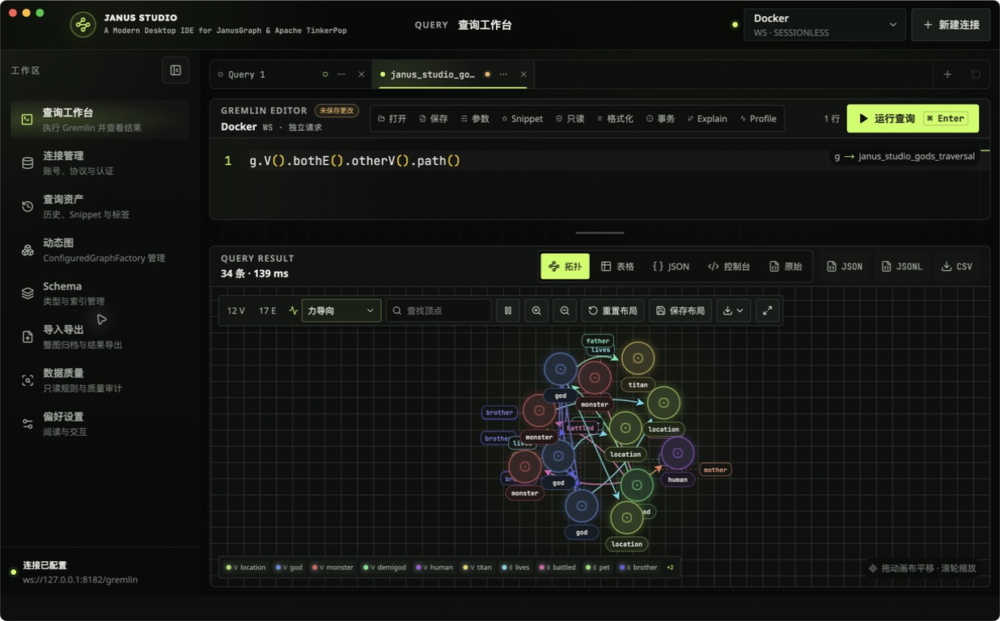
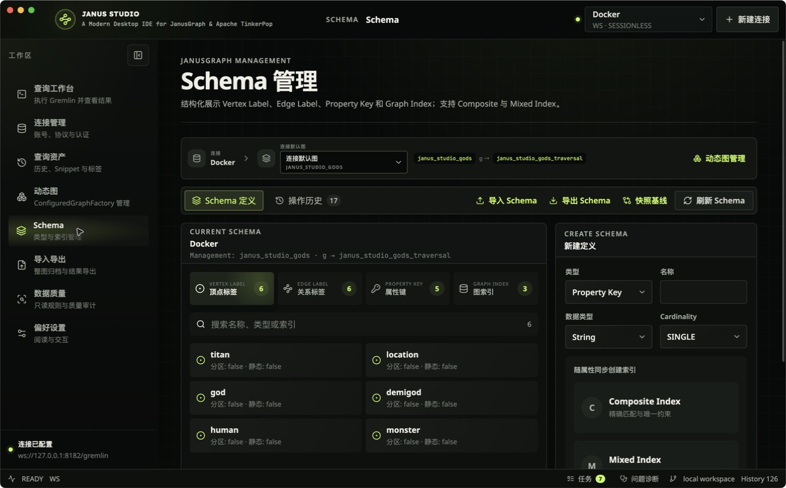

# Janus Studio

Janus Studio 是用于连接图数据库、执行 Gremlin 查询、查看拓扑和管理 JanusGraph 的跨平台桌面 IDE。


[](LICENSE)

应用不内置图数据库或示例数据，需要可访问的 JanusGraph 或兼容 Apache TinkerPop 的 Gremlin 服务；Schema、动态图和部分迁移功能依赖 JanusGraph 服务端能力及权限。

## 功能

- **连接管理**：多连接、分组与标签，支持 WS/WSS、HTTP/HTTPS、认证、TLS、代理和 SSH 隧道，以及分阶段连接测试。
- **查询工作台**：Gremlin 高亮、Schema 补全、参数绑定、多标签页、文件读写、Explain/Profile 和会话事务；工作区可在重启后恢复。
- **结果与拓扑**：标量、表格、JSON、控制台和原始响应视图；多种图布局、属性详情、布局保存，以及 PNG/JPG/SVG/JSON 拓扑导出和 JSON/JSONL/CSV 结果导出。
- **Schema 与动态图**：Label、Property Key、Composite/Mixed Index 管理，Schema 导入导出、快照比较，以及 ConfiguredGraphFactory 配置与实例管理。
- **整图迁移**：Janus Studio 归档与服务端 GraphSON 导入导出，持久化任务进度和显式停止、重试。
- **查询资产与数据质量**：历史、Snippet、文件夹和标签；可复用的只读检查规则、问题样本与完整审计结果导出。
- **设置与诊断**：深色、浅色和系统主题，多语言、字体和快捷键设置，以及本地问题诊断和脱敏诊断包。

## 效果预览

查询工作台：编辑 Gremlin，并在同一工作区查看查询结果和图拓扑。



<details>
<summary>Schema 管理：查看定义、创建属性与索引、导入导出和比较快照</summary>



</details>

## 安装与快速开始

### 获取应用

仓库配置的构建目标如下；该表表示打包配置，不代表每个平台均已完成实际安装验收。

| 平台 | 架构 | 安装包格式 |
| --- | --- | --- |
| macOS | Apple Silicon（arm64）、Intel（x64） | ZIP 应用包 |
| Windows | x64 | Squirrel 安装程序 |
| Linux | x64 | DEB、RPM |

可在 [GitHub Releases](https://github.com/Zorabi/janus-studio/releases) 查看已发布的版本及附件；若无对应制品，请从源码构建。安装前查看该版本的发布说明与验证信息，未完成平台验证的测试包不应视为正式发行版。

### 从源码运行

需要 Git、Node.js 22.x（至少 22.17.0，见 [.nvmrc](.nvmrc)）和 pnpm 8.11.0。

```bash
git clone https://github.com/Zorabi/janus-studio.git
cd janus-studio
pnpm install --frozen-lockfile
pnpm dev
```

### 首次查询

1. 新建连接，填写服务器地址、认证信息和服务端配置的 Traversal Source；使用连接测试检查可达性及权限。
2. 进入查询工作台，选择连接；使用动态图时，先选择目标图并核对图上下文。
3. 输入以下只读查询并点击“运行查询”，在拓扑、表格或 JSON 视图查看结果。

```groovy
g.V().limit(20)
```

示例假定 Traversal Source 为 `g`；空图会返回空结果，不会自动创建示例数据。

## 使用说明与兼容性

| 场景 | 条件与边界 |
| --- | --- |
| JanusGraph 版本 | CI 兼容测试配置覆盖 1.0.0、1.1.0 的 WS、Sessioned WS 和 HTTP；其他版本需自行验证。 |
| 其他 TinkerPop 服务 | 可使用兼容的 Gremlin 查询通道；JanusGraph 专属管理功能不能据此推定可用。 |
| 跨查询事务 | 需要 WS/WSS 的 Sessioned 模式；在同一查询标签页显式开启、提交或回滚。 |
| Schema 导入 | 先审阅变更计划，再输入完整目标图名；1.1 官方 JSON 专属字段在 1.0 中可能需要人工审阅。 |
| 整图迁移 | 服务端 GraphSON 需要本机 Docker 中转或服务器绝对路径；导入中断不会回滚已写入的数据。 |
| 停止任务 | HTTP(S) 只能停止客户端等待，不能保证服务端执行终止；WS/WSS 的中断能力取决于任务通道和服务端。 |
| 动态图管理 | 依赖 ConfiguredGraphFactory 配置、权限与集群状态；关闭当前节点引用后，服务端可能自动重新加载。 |

参数绑定需在查询标签页启用，并填写 JSON 对象，例如 `{"vertexId": 123}`；查询中直接使用 `g.V(vertexId)`。快捷键可在偏好设置中查看和修改。

清空数据、Drop 和 Schema 变更前应核对连接与目标图。生产连接支持写入保护，危险操作要求输入完整图名确认。更多边界见[发布已知限制](docs/发布已知限制.md)，企业网络配置见[企业连接与认证](docs/企业连接与认证.md)。

## 开发与测试

项目使用 pnpm workspace，桌面端基于 Electron Forge、Vite、React、TypeScript 和 Monaco Editor。

| 目录 | 职责 |
| --- | --- |
| `apps/desktop/src/main` | 主进程、连接、IPC、存储、文件与后台任务 |
| `apps/desktop/src/preload` | 安全的进程间 API 桥接 |
| `apps/desktop/src/renderer` | 界面、编辑器与图画布 |
| `packages/domain` | 领域类型与共享契约 |
| `packages/application` | 应用规则与数据转换 |
| `tests` | 单元、集成、兼容与打包应用测试 |

在仓库根目录执行：

```bash
pnpm typecheck
pnpm test
pnpm build
```

`pnpm test` 中的真实环境用例默认跳过，不需要连接现有数据库。`pnpm build` 为当前平台生成应用，输出在 `apps/desktop/out/`；例如 macOS ARM64 为 `apps/desktop/out/Janus Studio-darwin-arm64/Janus Studio.app`。`pnpm make` 生成可分发制品，输出在 `apps/desktop/out/make/`；Linux 打包还需 `fakeroot` 和 RPM 工具。

修改用户可见界面文字后运行 `pnpm i18n:generate`。需要验证数据库兼容性时，可单独运行以下命令；它会通过 Docker Compose 创建测试服务、执行测试，并清理测试容器和卷：

```bash
pnpm test:compat
```

该命令默认测试 JanusGraph 1.1.0，可通过 `JANUSGRAPH_VERSION` 环境变量指定 1.0.0。打包应用与真实连接测试的前提见[贡献指南](CONTRIBUTING.zh-CN.md)；架构说明见[需求分析与架构设计](docs/需求分析与架构设计.md)。

## 参与贡献

提交 Issue 前请搜索已有问题，提供应用版本、操作系统、服务端版本、复现步骤与脱敏错误信息。可通过应用的问题诊断入口生成诊断包，分享前请检查内容，不要附带凭据或真实业务数据。

代码贡献请先阅读[贡献指南](CONTRIBUTING.zh-CN.md)，保持改动聚焦，并附上相关验证结果。发布流程见[发布文档](docs/发布与签名.md)。

## 许可证

SPDX：`AGPL-3.0-only`。第三方依赖保留各自的版权与授权条款。

Copyright (c) 2026 dongx。

本项目基于 [GNU Affero General Public License v3.0](LICENSE) 发布。
